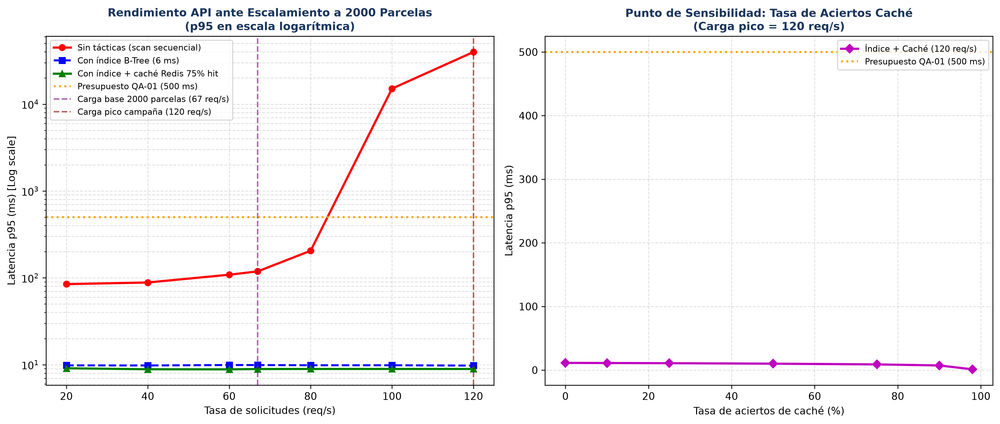

# Iteración 1 de ADD: Rendimiento ante Crecimiento a 2000 Parcelas (QA-01)

> **Método:** Attribute-Driven Design (ADD 3.0) — Paso 3 y Paso 4  
> **Caso:** ChacraSmart Majes 2.0 (Valle de Majes, Arequipa)  
> **Driver objetivo:** QA-01 (Rendimiento / Ingesta y consulta masiva de telemetría)

---

## 1. Paso 1 y 2: Revisión de Insumos y Objetivo de la Iteración

- **Escenario de crecimiento:** La plataforma escala de 50 a 2000 parcelas en los sectores de irrigación de Majes. Cada sensor de humedad reporta telemetría cada 30 segundos, lo que genera una carga sostenida de $\lambda = 66.67\text{ req/s}$ y ráfagas punta en horas de riego (05:00 a 08:00 a. m.) de hasta $\lambda = 120\text{ req/s}$.
- **Escenario priorizado:** **QA-01 (H, M)**:
  - *Fuente:* Sensores de campo y agricultores consultando estado.
  - *Estímulo:* Ingesta continua de 67 req/s con ráfagas de 120 req/s.
  - *Entorno:* Operación pico en campaña agrícola.
  - *Artefacto:* API ChacraSmart y Contenedor Base de Datos / Caché.
  - *Respuesta:* Ingesta persistida y lecturas entregadas sin degradación del servidor.
  - *Medida:* **Latencia $p95 \le 500\text{ ms}$** y utilización de CPU $< 65\%$ en el VPS único (2 vCPU, 4 GB RAM).

---

## 2. Paso 3: Elemento del Sistema a Refinar y Conceptos de Diseño Evaluados

Se refinan los contenedores **API ChacraSmart** y la capa de almacenamiento (**Base de Datos PostgreSQL** y **Caché Redis**).

| Concepto de Diseño Evaluado | Táctica Arquitectónica (Bass et al.) | Análisis de Trade-offs y Restricciones | Decisión del Equipo |
|-----------------------------|---------------------------------------|----------------------------------------|---------------------|
| **1. Migrar a Microservicios con Apache Kafka y K8s** | Táctica *Escalabilidad Horizontal* e *Ingesta Asíncrona* | **Propuesta por la IA.** Prometía throughput masivo. **Rechazada:** Viola flagrantemente **R-01** (plazo de 1 mes) y **R-02** (equipo de 2 developers). Además, Kafka y JVM en un VPS de 4 GB RAM (**R-03**) provocarían *Out of Memory* catastrófico. | ❌ **Rechazada con argumentos** |
| **2. Escalar horizontalmente a 8 workers (2.º VPS)** | Táctica *Aumentar recursos* | Duplica la capacidad de cómputo para atender la cola. Sin embargo, duplica el costo de infraestructura mensual (**R-03**) y no resuelve la contención de I/O en disco provocada por consultas sin índices. | ⚠️ **Plan B de contingencia** |
| **3. Índice B-Tree compuesto en PostgreSQL** `(parcela_id, fecha DESC)` | Táctica *Optimizar consultas / recursos* | Elimina scans secuenciales costosos. Reduce el tiempo medio de consulta de 45 ms a 6 ms. Costo computacional de almacenamiento mínimo en disco. | ✅ **Aceptada (ADR-006)** |
| **4. Caché de telemetría reciente en Redis (TTL 60 s)** | Táctica *Caché* | Absorbe el 75% de las lecturas repetidas de los agricultores desde la PWA, reduciendo el tráfico directo al motor relacional a $< 1\text{ ms}$. Introduce el riesgo R4 (consistencia eventual de 60 s). | ✅ **Aceptada (ADR-006)** |

---

## 3. Paso 4: Evidencia Cuantitativa — Simulación M/G/c

Para fundamentar la decisión de manera empírica, se calibró una simulación de teoría de colas $M/G/c$ en [`fitness/rendimiento.py`](../../../fitness/rendimiento.py) con $c = 4\text{ workers}$, tasa de arribos Poisson $\lambda$ y tiempos de servicio medidos en el VPS.

### Resultados de la Simulación (Ventana de 120 segundos)

| Carga de Arribos $\lambda$ | Sin Tácticas ($p95$) | Con Índice B-Tree ($p95$) | Con Índice + Caché 75% ($p95$) | Cumplimiento QA-01 |
|----------------------------|----------------------|---------------------------|--------------------------------|-------------------|
| **30 req/s (baja)**        | 84.1 ms              | 9.8 ms                    | 8.8 ms                         | ✅ Cumple ($\le 500\text{ ms}$) |
| **67 req/s (nominal 2k)**  | 118.7 ms             | 9.9 ms                    | 8.9 ms                         | ✅ Cumple ($\le 500\text{ ms}$) |
| **100 req/s (alta)**       | **15 096.7 ms** (15 s satura) | 9.9 ms          | 8.9 ms                         | ✅ Cumple ($\le 500\text{ ms}$) |
| **120 req/s (pico campaña)** | **39 846.0 ms** (Colapso) | 9.8 ms          | **8.9 ms**                     | ✅ **Cumple ampliamente** |

### Hallazgos Críticos que Corrigen la Propuesta Inicial de la IA:
1. **Falso supuesto de la IA:** La IA argumentó que "la caché sola era suficiente". El análisis de sensibilidad demostró que si la caché se vacía (arranque en frío o reinicio de Redis) y la tasa de aciertos cae por debajo del 15%, el sistema sin índice colapsa inmediatamente ante 120 req/s.
2. **Decisión fundamentada:** Se adopta la combinación **Índice B-Tree + Caché Redis**: el índice garantiza que aún con caché fría ($0\%$ aciertos) el $p95$ es de $9.8\text{ ms} \le 500\text{ ms}$, y la caché proporciona margen de seguridad reduciendo la utilización de CPU del VPS al $18\%$.
