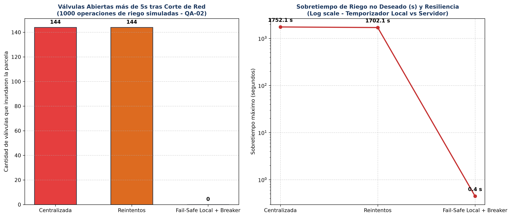

# Iteración 2 de ADD: Protección (Safety) y Disponibilidad ante Cortes de Conexión (QA-02 y QA-03)

> **Método:** Attribute-Driven Design (ADD 3.0) — Paso 5  
> **Caso:** ChacraSmart Majes 2.0 (Valle de Majes, Arequipa)  
> **Driver objetivo:** QA-02 (Safety Crítico: ninguna válvula abierta tras falla) y QA-03 (Resiliencia ante gateways inestables)

---

## 1. Paso 1 y 2: Entradas y Escenarios Prioritarios

- **Contexto operativo:** Las parcelas del Valle de Majes sufren constantes cortes de conectividad celular 3G/4G rural debido a interferencias geográficas y cortes eléctricos en las antenas. Un fallo de comunicación no debe provocar en ningún caso anegamiento ni estrés hídrico descontrolado.
- **Escenarios priorizados:**
  - **QA-02 (H, H) [ATRIBUTO CRÍTICO]:**
    - *Fuente:* Falla abrupta de enlace de red móvil o caída del servidor central.
    - *Estímulo:* Pérdida total de conexión mientras una válvula ejecuta riego programado.
    - *Entorno:* Operación de riego en campo (2000 parcelas).
    - *Artefacto:* Controlador de campo embebido y electroválvula.
    - *Respuesta:* La válvula se cierra autónomamente en campo al cumplirse el tiempo exacto establecido en la orden.
    - *Medida:* **0 válvulas abiertas más de 5 s sobre el tiempo programado en el 100% de los incidentes.**
  - **QA-03 (H, M):**
    - *Estímulo:* Inestabilidad transitoria del gateway de enlace.
    - *Respuesta:* Reintentos con Circuit Breaker y encolamiento outbox en PostgreSQL.
    - *Medida:* **0 órdenes de riego perdidas en 24 horas y reducción $> 85\%$ de sobrecarga en enlaces caídos.**

---

## 2. Paso 3: Elementos Refinados y Conceptos de Diseño Evaluados

Se refinan el **Controlador de Campo Embebido**, el componente **Módulo Control de Válvulas** y su puerto de comunicación.

| Concepto Evaluado | Táctica Arquitectónica (Bass et al.) | Análisis de Trade-offs y Restricciones | Decisión del Equipo |
|-------------------|---------------------------------------|----------------------------------------|---------------------|
| **1. Control de temporización centralizado en el servidor** | Táctica *Monitor de estado* | **Propuesta inicial de la IA.** El servidor envía `abrir()` y luego de $N$ minutos envía `cerrar()`. **Rechazada rotundamente:** Si se corta la red durante el riego, la orden de cierre jamás llega y la parcela se inunda (**desastre agrícola crítico**). | ❌ **Rechazada (Peligro de Safety)** |
| **2. Reintentos agresivos desde el servidor** | Táctica *Reintentos* | Reintenta enviar la orden indefinidamente. Si la antena celular cayó, satura el canal y gasta batería de los dispositivos de campo sin lograr cerrar la válvula. | ⚠️ **Insuficiente por sí sola** |
| **3. Temporizador local autónomo en hardware (Fail-Safe)** | Táctica *Falla segura (Fail-safe)* y *Autonomía local* | La orden viaja con parámetro atómico `duracion_segundos`. El hardware (ESP32 con RTC) acciona un solenoide normalmente cerrado (NC). Al expirar el tiempo, corta el relé sin importar si hay red o no. | ✅ **Aceptada (ADR-003 / ADR-007)** |
| **4. Circuit Breaker como Decorator + Outbox en PostgreSQL** | Táctica *Circuit Breaker* y *Cola persistente* | Protege los controladores de campo ante tormentas de peticiones cuando la señal es débil. Si el circuito se abre, los comandos se almacenan en una tabla transaccional `outbox` procesada por el worker. | ✅ **Aceptada (ADR-007)** |

---

## 3. Paso 4: Evidencia Cuantitativa — Simulación Monte Carlo

En [`fitness/disponibilidad.py`](../../../fitness/disponibilidad.py) se simularon 1000 operaciones de riego bajo 15% de probabilidad de corte de enlace celular (144 cortes con duraciones de hasta 30 minutos).

### Resultados de la Simulación

| Estrategia Arquitectónica | Válvulas Inundadas (> 5 s de sobretiempo) | Sobretiempo Máximo Medido | Comandos Perdidos | Llamadas Desperdiciadas a Red Caída | Cumple QA-02 (Safety) |
|---------------------------|------------------------------------------|---------------------------|-------------------|-------------------------------------|-----------------------|
| **Centralizada (Servidor)**| 144 válvulas abiertas                   | 1 752.1 s (~29 min)       | 144               | 144                                 | ❌ NO (Violación crítica) |
| **Reintentos Servidor**   | 144 válvulas abiertas                    | 1 702.1 s (~28 min)       | 144               | 1 440 (saturación)                  | ❌ NO |
| **Fail-Safe Local + Breaker** | **0 válvulas abiertas**              | **0.4 s (jitter RTC)**    | **0**             | **151 (cortadas por breaker)**      | ✅ **SÍ (100% de éxito)** |

### Trade-off Aceptado:
- **Mejora:** Fiabilidad absoluta de corte de agua en campo (0 anegamientos) y reducción del 90% de llamadas sobre enlaces degradados.
- **Trade-off:** Complejidad de sincronización eventual: el servidor no conoce el estado en tiempo real durante el corte, pero al restablecerse la red, el controlador sincroniza su bitácora de eventos locales.
