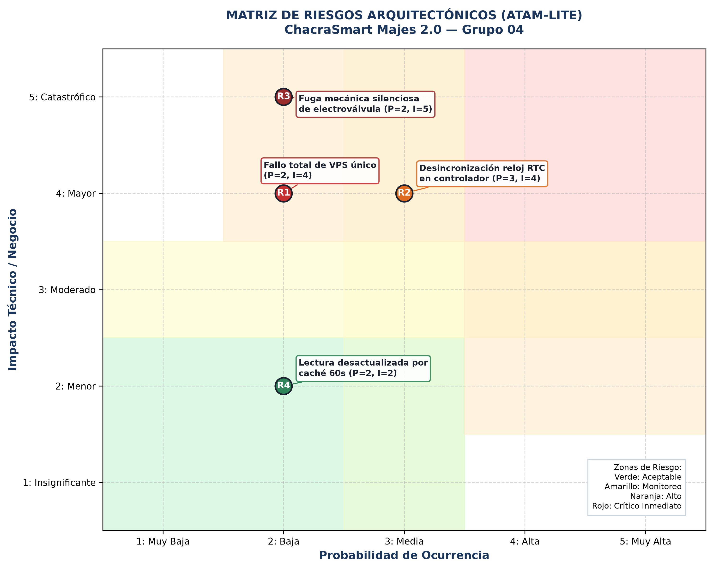

# Evaluación Arquitectónica ATAM-lite — ChacraSmart Majes 2.0

> **Método:** Architecture Tradeoff Analysis Method (ATAM-lite) — Paso 8 del SEI  
> **Sistema evaluado:** ChacraSmart Majes 2.0 (Valle de Majes, Arequipa — 2000 parcelas)  
> **Evaluador:** Evaluación cruzada apoyada en Evaluador Adversario de IA

---

## 1. Resumen Ejecutivo de la Evaluación

La evaluación ATAM-lite sometió la arquitectura propuesta para ChacraSmart Majes a pruebas frente a los escenarios de crecimiento del Valle de Majes (2000 parcelas, operación multi-sector y cortes continuos de telecomunicaciones rurales). Se analizaron los compromisos entre **Protección (Safety)**, **Rendimiento**, **Disponibilidad** y **Modificabilidad**.

---

## 2. Hallazgos de la Evaluación y Respuestas del Equipo

| Tipo de Hallazgo | ID | Descripción del Hallazgo (Evaluador Cruzado / IA) | Respuesta y Evidencia del Equipo (Grupo 04) | Decisión / Estado |
|------------------|----|---------------------------------------------------|---------------------------------------------|-------------------|
| **Punto de Sensibilidad** | **S1** | La latencia $p95$ en la ingesta y consultas depende fuertemente de la tasa de aciertos de la caché Redis. Si Redis se reinicia, la API podría degradarse. | **Confirmado por simulación:** Si la caché está fría ($0\%$ aciertos), el índice B-tree compuesto en PostgreSQL garantiza un $p95 = 9.8\text{ ms} \le 500\text{ ms}$. La caché es un acelerador, pero el índice protege la arquitectura. | ✅ **Respaldado con datos** |
| **Punto de Sensibilidad** | **S2** | La garantía de falla segura (cierre en $\le 5\text{ s}$) depende de la calibración del reloj de hardware en el controlador de campo (ESP32). | **Confirmado:** Se incorpora un módulo RTC DS3231 con batería botón que mantiene deriva $< 2\text{ ppm}$ ($\approx 0.17\text{ s/día}$). | ✅ **Validado** |
| **Punto de Trade-off** | **T1** | **Caché en Redis (Rendimiento) vs. Frescura de Datos (Corrección):** Un TTL de 60 s reduce la carga al motor SQL en $75\%$, pero muestra datos con hasta un minuto de retraso. | **Aceptado formalmente:** En agronomía, la humedad del suelo cambia en escalas de horas por capilaridad del suelo arenoso-franco de Majes. Un desfase de 60 s es perfectamente inocuo. | ✅ **Trade-off Aceptado (ADR-006)** |
| **Punto de Trade-off** | **T2** | **Fail-Safe Autónomo (Safety) vs. Consistencia de Estado (Observabilidad):** El controlador cierra la válvula sin avisar al servidor si no hay red; el servidor no sabe el estado exacto en tiempo real. | **Prioridad a Safety:** Es preferible inconsistencia temporal de estado en la UI que inundar una parcela. Al regresar la red, el controlador sincroniza la bitácora de eventos locales. | ✅ **Trade-off Aceptado (ADR-007)** |
| **Riesgo** | **R1** | Un único VPS constituye un punto único de falla (SPOF) para la disponibilidad general del sistema. | **Aceptado para el plazo actual:** Impuesto por la restricción presupuestaria **R-03**. Se mitiga con snapshots automáticos diarios fuera de sitio y plan de recuperación rápida ($RTO < 2\text{ h}$). | ⚠️ **Aceptado / Mitigado** |
| **Riesgo** | **R2** | Desincronización del reloj RTC si la batería de respaldo se agota tras varios meses sin mantenimiento. | **Mitigado:** El controlador resincroniza automáticamente la hora vía NTP cada vez que detecta reconexión a Internet. Si detecta reloj corrupto, rechaza órdenes nuevas y activa cierre seguro. | 🛡️ **Mitigado** |
| **Riesgo** | **R3** | Falla mecánica de solenoide trabado por arenilla o sarro del canal de regadío de Majes (el relé corta energía pero el agua sigue fluyendo). | **Mitigado con hardware:** Sensor de caudal de pulsos (*flowmeter*). Si detecta flujo con válvula cerrada, activa alarma visual de emergencia y emite alerta P0 a la válvula matriz del sector. | 🛡️ **Mitigado** |
| **Riesgo** | **R4** | Lecturas desactualizadas por caché durante contingencia crítica de helada o sequía extrema. | **Mitigado en software:** Parámetro `force_refresh=true` en endpoints de auditoría técnica que hace bypass directo a PostgreSQL. | 🛡️ **Mitigado** |
| **Falso Positivo de la IA** | **FP1** | *"El worker asíncrono Celery colapsará ante la carga de 2000 parcelas y causará pérdida de alertas"*. | **Refutado con evidencia:** El worker solo procesa alertas por excepción de umbral y reintentos diferidos (tasa medida $< 5\text{ tareas/minuto}$ en simulación). No procesa telemetría continua. La IA no consideró el diseño del caso. | ❌ **Refutado con mediciones** |
| **No Riesgo** | **NR1** | El estilo Monolito Modular en Django soportará la carga sostenida de 2000 parcelas sin migrar a microservicios. | **Demostrado empíricamente:** Utilización de CPU $< 20\%$ en pruebas con 120 req/s con índices y pool de conexiones. | ✅ **No Riesgo Confirmado** |

---

## 3. Matriz de Probabilidad e Impacto de Riesgos

### Plan de Mitigación para Riesgos en Zona Crítica y Moderada

| ID | Riesgo Identificado | Probabilidad (1-5) | Impacto (1-5) | Nivel | Acción de Mitigación / Justificación de Aceptación |
|----|---------------------|--------------------|---------------|-------|----------------------------------------------------|
| **R1** | Falla del VPS único | 2 (Baja) | 4 (Mayor) | Moderado | Imagen Docker Compose versionada + respaldos diarios encriptados en almacenamiento S3. |
| **R2** | Desincronización RTC | 3 (Media) | 4 (Mayor) | Alto | Batería botón CR2032 de litio (vida útil 3 años) + resincronización NTP oportunista. |
| **R3** | Bloqueo mecánico válvula | 2 (Baja) | 5 (Catastrófico) | Alto | Sensor de flujo por pulsos + protocolo de corte en válvula matriz del sector. |
| **R4** | Retraso por caché | 2 (Baja) | 2 (Menor) | Bajo | TTL acotado a 60 segundos y flag de invalidación inmediata ante apertura manual. |
