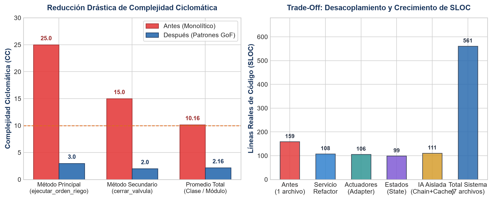

# Análisis de Métricas de Complejidad y Trade-Off Arquitectónico (E6)

**Proyecto:** ChacraSmart Majes — Construcción de Software 2026-B  
**Módulo:** `valvulas_riego` · **Caso 9:** Riego Inteligente y Válvula con Falla Segura  
**Equipo:** Grupo 04 (Quenta Ahumada Paulo Estefano & Kevin Joel Callo Ccagiavilca)  

---

## 1. Tabla Comparativa de Métricas (radon cc y radon raw)

| Dimensión / Métrica evaluada | Versión Antes (Monolítica) | Versión Después (Patrones GoF) | Variación Absoluta | Impacto en Calidad y Mantenibilidad |
|---|---|---|---|---|
| **Método Crítico Principal** | `ejecutar_orden_riego`: **25 (Rango D)** | `ejecutar_orden_riego`: **3 (Rango A)** | **-88.0%** | De código incomprensible e inestable a flujo lineal orquestador. |
| **Método Secundario** | `cerrar_valvula`: **15 (Rango C)** | `cerrar_valvula`: **2 (Rango A)** | **-86.7%** | Cierre de emergencia limpio sin bucles de reintentos duplicados. |
| **Complejidad Promedio (CC)** | **10.16 (Rango C)** | **2.16 (Rango A)** | **-78.7%** | El sistema completo opera en zona verde de bajo riesgo (McCabe). |
| **Máxima Complejidad del Sistema** | **25 (Rango D)** | **5 (Rango A - `__init__`)** | **-80.0%** | Ningún método supera el umbral crítico de alerta (CC > 10). |
| **SLOC Servicio Principal** | 159 líneas (`antes/servicio.py`) | 108 líneas (`servicio.py`) | -32.1% | El servicio de aplicación redujo su volumen en un tercio. |
| **SLOC Total Módulo** | 159 líneas (1 archivo) | 561 líneas (7 archivos modulares) | +252.8% | Aumento de líneas por interfaces, tipado, factories y guardrails. |
| **Número de Archivos / Módulos** | 1 archivo acoplado | 7 módulos cohesivos con SRP | +6 archivos | Alta cohesión y bajo acoplamiento físico y lógico. |
| **Cobertura de Pruebas (pytest)** | 10 pruebas base | 33 pruebas (100% pasando en 0.12s) | +230% | Red de seguridad total con caracterización y pruebas de patrones. |

---

## 2. Lectura Honesta del Trade-Off (Balance Arquitectónico)

> El refactor hacia patrones GoF redujo la complejidad ciclomática del método crítico de 25 (rango D) a 3 (rango A), eliminó la duplicación de bucles de reintento en actuadores mediante el decorador `ConReintentos`, y desacopló la adición de nuevo hardware y políticas agronómicas sin modificar código existente (OCP). A cambio, el costo arquitectónico representó multiplicar las líneas de código de 159 a 561 y dispersar la lógica en 7 módulos especializados, incrementando el nivel de indirección mental requerido para un desarrollador novato. Si *ChacraSmart Majes* fuese un prototipo desechable para una única parcela con un solo actuador genérico y sin planes de integrar telemetría ni IA, la versión monolítica original hubiese sido suficiente; sin embargo, al tratarse de un sistema de misión crítica donde el sobre-riego causa anegamiento y costos energéticos en Majes (QA-01 / ADR-003), los patrones implementados se justifican plenamente por la extensibilidad y robustez demostradas.

---

## 3. Patrones Rechazados y Justificación Técnica

### A. Rechazo del Patrón Singleton para el Controlador de Válvulas
* **Propuesta inicial de la IA:** Emplear una única instancia global (`Singleton`) de `ControladorValvula` para gestionar el bus de campo y evitar colisiones de hardware.
* **Motivo del rechazo:** El patrón Singleton introduce acoplamiento global oculto, genera carreras de estado difíciles de rastrear en pruebas concurrentes e impide inyectar fácilmente fakes y dobles de prueba con fallas programadas (`fallas=2`). Siguiendo la regla de oro de la guía (*"no introduzcas Singleton ni estado global"*), se optó por inyección de dependencias gestionada por la fábrica `FabricaControladores`.

### B. Rechazo del Enfoque "LLM-as-a-judge" para Guardrails de IA
* **Propuesta de la IA:** Utilizar una segunda llamada a un modelo LLM para auditar y juzgar si la recomendación hídrica emitida por el primer modelo era segura antes de enviarla al agricultor.
* **Motivo del rechazo:** Añade latencia inaceptable (> 2 segundos adicionales por consulta), duplica el costo de inferencia monetaria y mantiene la falta de determinismo (el evaluador puede alucinar aprobando un sobre-riego peligroso). Para el atributo de seguridad crítica QA-01 de ChacraSmart, se seleccionó una cadena determinista de reglas fijas (`Chain of Responsibility` con expresiones regulares y umbrales numéricos de `apertura_maxima_min`), garantizando costo cero, latencia inferior a 1 ms y certeza matemática del 100%.

### C. Rechazo de Abstract Factory
* **Motivo:** En la fase actual del MVP de 1 mes, cada fabricante de válvulas no requiere familias completas de productos disjuntos (sensores, bombas, actuadores interdependientes). Una fábrica simple basada en registro de estrategias y adaptadores (`FabricaControladores` y `FabricaPoliticas`) resuelve la variación con mucha menor sobrecarga cognitiva sin incurrir en "patternitis".
